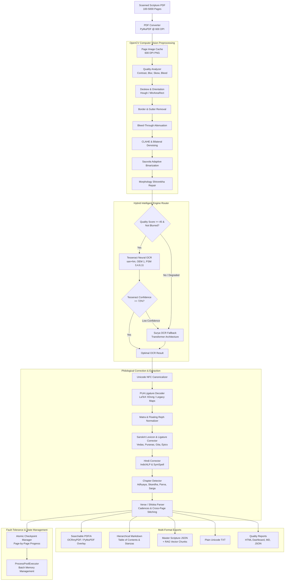

# Dharma Granth Scripture OCR: System Architecture

---

## 1. Core Architectural Pillars

### 1.1 100% Offline Air-Gapped Invariant
- **Zero Cloud APIs**: No OpenAI, Google Vision, AWS Textract, or Azure Cognitive Services.
- **Local Neural Models**: Tesseract LSTM (`tessdata_best` models `san.traineddata` and `hin.traineddata`) and Surya OCR local weights run completely on local CPU or NVIDIA GPU.
- **Zero Subscription Costs**: Built entirely on free, open-source permissive tools (Apache 2.0 / MIT / BSD).

### 1.2 600 DPI Scripture Rendering
Devanagari script relies heavily on fine typographic details:
- **Shirorekha** (top horizontal headline).
- **Halants / Viramas** (्) denoting consonant clusters.
- **Vedic Swaras** (Udatta `॑` and Anudatta `॒`).
- **Anusvara** (ं) vs **Chandrabindu** (ँ).
- **Nuanced Matras** (ि vs ी, ु vs ू, ृ vs ॄ).

Standard 300 DPI scans blur these fine marks into ink specks. The pipeline enforces **600 DPI rasterization** via PyMuPDF C-native bindings, generating high-frequency edge information essential for accurate character recognition.

### 1.3 Hybrid Engine Routing (Tesseract + Surya)
- **Tesseract 5 LSTM (OEM 1)**: Highly optimized C++ implementation. Evaluates multiple Page Segmentation Modes (PSMs: 3, 4, 6, 11) dynamically and processes standard high-contrast pages at 1.5–3.0 seconds per page.
- **Surya OCR (Vision Transformer)**: Deep learning layout detection and sequence recognition model. Activated automatically whenever page quality is below threshold, text is severely warped or blurred, or Tesseract confidence falls below 72%. Excels at two-column commentaries, marginal glosses, and 19th-century lithographic script.

### 1.4 Philological Sanskrit & Hindi Post-Processing
Scanned Indian PDFs from the 1990s through 2010s often utilized non-Unicode legacy fonts (KrutiDev, Chanakya, DV-TTSurekh, or LaTeX XDvng font encodings using the Unicode Private Use Area `\uE000 - \uF8FF`).
- **PUA Ligature Decoder**: Maps over 50 legacy Private Use Area glyphs directly to canonical Unicode Devanagari conjuncts (`क्त`, `द्ध`, `द्य`, `द्व`, `ज्ञ`, `क्ष`, etc.).
- **Matra & Reph Normalization**: Corrects inverted reph markers (Consonant + Halant + Ra) and reconnects detached matras.
- **Domain Lexicon**: Built-in verification dictionary covering Vedas, Upanishads, Mahabharata, Ramayana, and Puranas, ensuring correct spelling of core vocabulary.

### 1.5 Cross-Page Boundary Stitcher
Traditional OCR pipelines process pages as isolated islands. In classical Puranas and epics, a 32-syllable Anustubh shloka frequently begins on the bottom line of Page N and concludes on the first line of Page N+1. The verse extraction engine preserves dangling lines across page transitions and stitches them into unified stanza objects.

### 1.6 Atomic Checkpoint & Fault Recovery
Processing a 1,500-page Purana scan can take several hours on CPU hardware. The pipeline employs an atomic write-and-replace checkpointing system. If power fails or the job is paused, execution resumes from the exact page where it stopped, saving hours of redundant compute.
