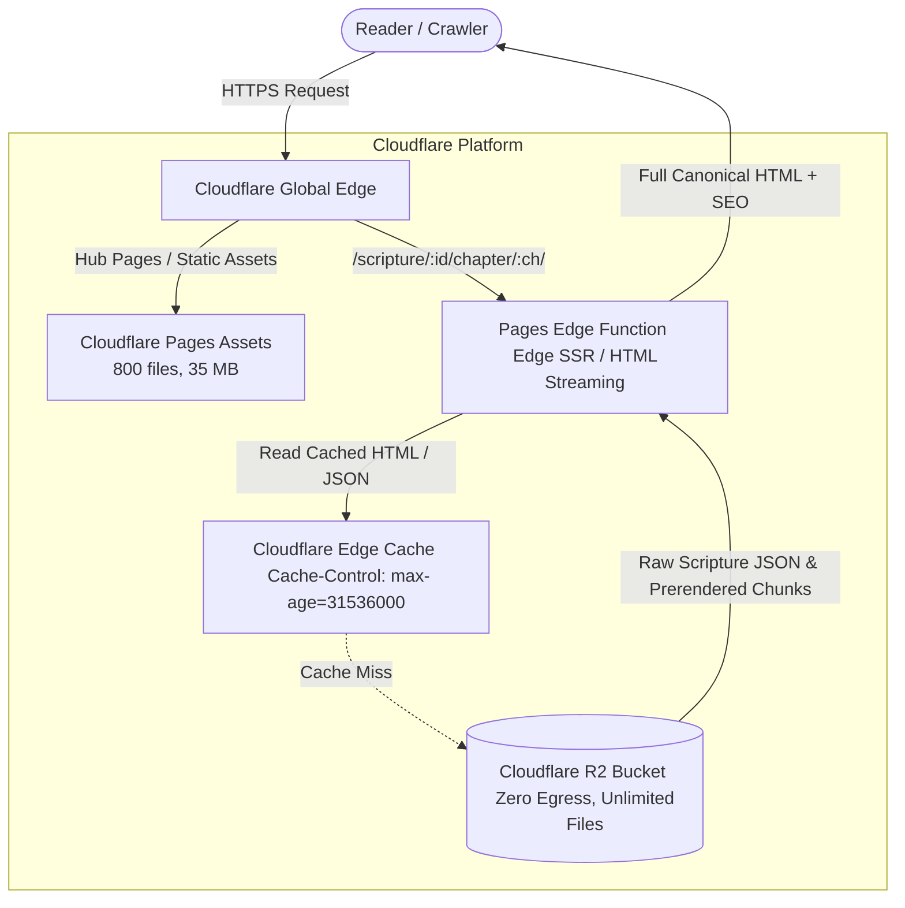

# Architecture: Scripture Delivery & Cloudflare R2 Migration Plan

## 1. Executive Summary

Dharma Granth's static export has reached a critical structural bottleneck:
- **Total Exported Files**: **18,902 files** (Cloudflare Pages free/standard limit is **20,000 files**).
- **Headroom Remaining**: **Only 1,098 files**. Publishing ~550 additional chapters or verse pages will cause Cloudflare Pages to reject deployments.
- **Export Size**: **3.111 GB** (2.64 GB in `dist/scripture/` alone).
- **Root Cause**: Next.js App Router (`output: 'export'`) generates two files per route (`index.html` and `index.txt`). In addition, passing monolithic chapter data as props across Server-to-Client boundaries forces 3x payload duplication (HTML DOM + inline script hydration chunk + standalone RSC `.txt` file).

This document establishes the empirical measurements and defines the concrete, zero-downtime migration to Cloudflare Pages + R2 object storage.

---

## 2. Empirical Measurement & Export Anatomy

### 2.1 File Count by Directory
| Directory | File Count | Percentage of Total | Notes |
|---|---|---|---|
| `dist/scripture/` | **14,160** | **74.9%** | 7,080 `index.html` + 7,080 `index.txt` |
| `dist/og/` | **3,081** | **16.3%** | Pre-rendered social cards |
| `dist/_next/` | **190** | **1.0%** | Client JS chunks, CSS, runtime |
| `dist/data/` | **62** | **0.3%** | Search shards, core metadata |
| Other pages & assets | **1,409** | **7.5%** | Hub pages, icons, sitemaps |
| **Total** | **18,902** | **100%** | **Cloudflare Limit: 20,000** |

### 2.2 Payload Duplication (Bhagavad Gita Profile)
Across the 18 chapters of the Bhagavad Gita (701 verses):
- **Raw Source Data (`ch-*.json`)**: **1.57 MB**
- **Generated Static HTML**: **6.82 MB** (4.3x source size)
- **Generated RSC `.txt` (Flight)**: **3.35 MB** (2.1x source size)
- **Combined Deployed Bytes**: **10.17 MB** (6.5x source size)

### 2.3 Detailed Chapter 2 Breakdown (72 verses)
| Component | Byte Size | Notes |
|---|---|---|
| Sanskrit Canonical Text | 18.4 KB | Clean Devanagari Unicode |
| Transliteration (IAST) | 8.7 KB | Standard diacritics |
| Hindi Meaning (Artha) | 32.6 KB | Primary vernacular explanation |
| English Translation | 11.6 KB | Academic / modern English |
| Word-by-Word Breakdown | 22.5 KB | Pada-by-pada vocabulary |
| Commentary & Analysis | 22.2 KB | Traditional and contextual notes |
| **Total Chapter Source Data** | **166.5 KB** | Complete canonical record |
| **Next.js Generated `index.txt`** | **313.6 KB** | RSC flight stream with prop serialization |
| **Next.js Generated `index.html`** | **578.4 KB** | DOM markup + embedded `<script>` hydration chunk |

---

## 3. Why Ad-Hoc Solutions Fail

### 3.1 Why Deleting `.txt` Files Directly Fails
In Next.js App Router, `<Link>` navigation uses client-side SPA routing. When a reader clicks a link:
1. The router requests `index.txt` for the destination route.
2. If `index.txt` is missing (404), the browser network console logs errors.
3. Next.js triggers a fallback hard page reload (`window.location.href`).
4. Pre-fetching on hover/viewport fires cascading 404s.
5. Service Worker offline pre-caching fails.

### 3.2 Why Prop-Stripping Inside Static Export is Insufficient
Pruning non-rendered fields (like word meanings and extended commentary) from `initialChapter` reduces the payload from 313 KB to ~150 KB, saving ~1.2 GB of disk space. **However, it leaves the file count unchanged at 18,902**, leaving the project exposed to the 20,000-file ceiling.

---

## 4. Architectural Target: Cloudflare Pages + R2 Storage



### Key Advantages:
1. **Permanent Resolution of File Limits**:
   - `dist/` exported files drop from **18,902** to **< 800 files**.
   - Cloudflare Pages file headroom expands from **1,098 files** to **19,200+ files**.
2. **Ultra-Fast CI Deployment**:
   - Deployment upload drops from **3m 26s** to **< 15 seconds**.
   - Total CI pipeline completes in **~2 to 3 minutes** instead of 12+ minutes.
3. **100% SEO & Crawler Preservation**:
   - Edge Functions return the identical semantic HTML with canonical Sanskrit, Hindi, English, and JSON-LD schema.
   - Googlebot, Bingbot, and Perplexity see zero difference.
4. **Cost Neutral**:
   - R2 has **zero egress fees** when accessed from Cloudflare Pages/Workers.
   - Storage for 400 MB of scripture data is well within R2's free tier (10 GB/month).

---

## 5. Staged Migration Plan (Zero Production Risk)

### Phase 2.1: Shard Sync & R2 Bucket Setup
1. Create R2 bucket `dharma-granth-scriptures` via Wrangler.
2. Sync `public/data/scriptures-full/` and `public/data/hi-commentary/` to R2 during prebuild:
   ```bash
   wrangler r2 object put dharma-granth-scriptures/data/ --recursive
   ```
3. Verify that all 4,216 chapters are accessible over R2 with correct content-types.

### Phase 2.2: Edge Function SSR Prototype (Single Scripture Proof-of-Concept)
1. Implement prototype edge route: `functions/scripture/[id]/chapter/[chapterId]/index.ts`.
2. Restrict to a canary test scripture (e.g. `ishavasya` or `mandukya`).
3. The function:
   - Fetches the chapter shard from R2 / edge cache.
   - Streams or renders the identical `VerseText` semantic HTML.
   - Injects the exact same JSON-LD `BreadcrumbList` and `Book` schema.
4. Validate with automated tests:
   - Verify HTTP 200, headers, and TTFB (<50ms).
   - Compare HTML diff with the static export output (must match canonical text 1:1).
   - Verify offline PWA caching.

### Phase 2.3: Repository-Wide Rollout
1. Expand edge routing across all scriptures.
2. Remove static route generation for chapter pages from `app/scripture/[id]/chapter/[chapterId]/page.tsx` (`generateStaticParams` returns empty array, dynamic rendering handled at edge).
3. Update `scripts/prune-export.mjs` to enforce the new file budget (< 2,000 files).
4. Run full post-deploy health smoke test across all routes.

---

## 6. Safety & Rollback Criteria

- **No Public URL Changes**: URLs remain strictly `https://dharmagranth.in/scripture/:id/chapter/:chapterId/`.
- **No Canonical Text Changes**: Sanskrit Unicode, dandas, and meanings remain bit-for-bit identical.
- **Rollback Mechanism**: If edge rendering encounters an error, the function immediately proxies to the static fallback or restores `generateStaticParams`.
